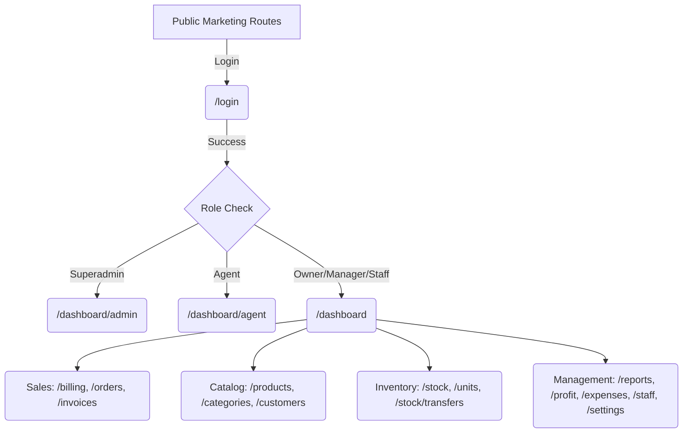

# Stock & POS Management Frontend - Project Index

This document provides a comprehensive overview of the frontend architecture, routing, state management, services, and components of the application. It is designed to help developers and AI agents quickly understand the codebase without needing to read every file.

## 1. Project Overview

**Purpose of the Application**
A comprehensive Point of Sale (POS), Inventory, and Business Management platform. It supports multi-tenant architecture (businesses, outlets) and role-based access control (Superadmin, Agent, Owner, Manager, Staff). It features billing, stock management, order tracking, customer management (Khata), and detailed reporting.

**Tech Stack**
- **Framework:** Next.js (App Router)
- **UI Library:** React, Tailwind CSS, shadcn/ui, React Aria Components, Lucide Icons
- **State Management:** Redux Toolkit (local state & persistence), `@tanstack/react-query` (server state)
- **API Client:** Axios with custom wrapper for standard response formats & offline queueing
- **Real-time:** Socket.IO for real-time notifications and updates
- **Styling:** Tailwind CSS with utility functions (`clsx`, `tailwind-merge`)

**Folder Structure**
```text
/app               # Next.js App Router pages and layouts
/components        # Reusable UI components (auth, billing, layout, ui, etc.)
/hooks             # Custom React hooks
/lib               # Utilities, formatting, constants, types, API client
/services          # API interaction layer (one file per domain)
/store             # Redux store configuration and slices
```

**Overall Architecture**
The app is a client-heavy Next.js application using standard App Router conventions.
- **Server State:** Handled by React Query to cache and synchronize API responses.
- **Client State:** Handled by Redux for complex local interactions (e.g., Billing Cart, User Auth session).
- **Network Resilience:** Uses an `offline-queue` mechanism to cache offline POST requests and sync them when the device comes back online.
- **Authentication:** Token-based authentication using standard JWT headers. Auth state is persisted in Redux and LocalStorage.

---

## 2. Routing Flow

The application routing is divided into distinct zones based on authentication and user roles.



**Navigation Flow:**
1. Unauthenticated users land on `/(marketing)/*` pages.
2. Clicking Login takes them to `/login` (supports email/password and OTP).
3. Post-login, they are redirected based on their role (`APP_ROUTES` in `lib/routes.ts`).
4. Inside `/dashboard`, the `AppShell` provides sidebar and bottom navigation for mobile.

---

## 3. Pages

### Marketing & Auth
- **`app/(marketing)/*`**: Landing page, About, Contact, Pricing, Services.
- **`app/login/page.tsx`**: 
  - *Purpose*: User authentication.
  - *State*: Local component state for login steps.
  - *API*: `authService.loginWithPassword`, `checkEmail`, `verifyOtp`.
- **`app/invite/[token]/page.tsx`**: Handling invitation links to join a business.

### Dashboard Core
- **`app/dashboard/layout.tsx`**: Wraps the dashboard with `AppShell` and `RequireAuth`.
- **`app/dashboard/page.tsx`**: Main overview dashboard. Fetches stats and displays widgets.

### Sales & Billing
- **`app/dashboard/billing/page.tsx`**: 
  - *Purpose*: Point of Sale (POS) interface.
  - *State*: Redux (`billingSlice`).
  - *Components*: `BillingPaymentModal`, `CustomerPicker`, product grids.
- **`app/dashboard/orders/page.tsx`**: View and manage past orders.
- **`app/dashboard/invoices/page.tsx`**: View generated GST invoices.

### Catalog & Customers
- **`app/dashboard/products/page.tsx`**: Product catalog management.
- **`app/dashboard/categories/page.tsx`**: Category tree management.
- **`app/dashboard/customers/page.tsx`**: Customer listing and Khata (ledger) management.

### Inventory
- **`app/dashboard/stock/page.tsx`**: Current stock levels, manual adjustments.
- **`app/dashboard/stock/transfers/page.tsx`**: Stock transfers between outlets.
- **`app/dashboard/units/page.tsx`**: Measurement unit definitions.

### Management & Reports
- **`app/dashboard/profit/page.tsx`**: Detailed Profit & Loss calculations.
- **`app/dashboard/reports/page.tsx`**: Analytics charts and data tables.
- **`app/dashboard/expenses/page.tsx`**: Tracking daily operational expenses.
- **`app/dashboard/staff/page.tsx` & `roles/page.tsx`**: RBAC management.
- **`app/dashboard/settings/page.tsx`**: Business and outlet level settings.

### Superadmin Platform (`/dashboard/admin/*`)
- **Purpose**: System-wide management for superadmins.
- **Pages**: `/businesses`, `/agents`, `/users`, `/subscriptions`, `/plans`, `/payments`.

### Agent Portal (`/dashboard/agent/*`)
- **Purpose**: Portal for sales agents to manage their clients and view commissions.
- **Pages**: `/clients`, `agent/page.tsx` (Dashboard).

---

## 4. Components

### Layout & Global
- **`components/layout/app-shell.tsx`**: Main structural component. Includes sidebar, bottom nav (mobile), top bar.
- **`components/auth/auth-provider.tsx`**: Core React Context for Auth state. Provides `useAuth` hook. Handles token, user info, login/logout functions, offline queue flush on connect.
- **`components/auth/require-auth.tsx`**: Route guard ensuring user is logged in.
- **`components/auth/role-gate.tsx` & `permission-gate.tsx`**: Component-level access control rendering children based on roles/permissions.
- **`components/global-socket-listener.tsx`**: Listens for global Socket.IO events (e.g., `notification:new`, `subscriptionUpdated`).

### Billing
- **`components/billing/billing-payment-modal.tsx`**: 
  - *Purpose*: Finalizes a sale. Handles payment methods, split payments, Khata selection.
  - *State*: Connects to Redux `billingSlice` to finalize the cart.
- **`components/billing/customer-picker.tsx`**:
  - *Purpose*: Selects a customer for Khata payments or order association.

---

## 5. Services / API Layer

All API requests go through `lib/api-client.ts`, which uses Axios (`lib/axiosInstance.ts`). The API client unwraps the standard `{ success, data, meta }` response envelopes.

- **`auth.service.ts`**: Login, Registration, OTP handling, Get User Profile.
- **`product.service.ts`**: CRUD for products, bulk import.
- **`order.service.ts`**: Fetching, creating, voiding POS orders.
- **`customer.service.ts`**: CRUD for customers, getting ledger/khata, adding payments.
- **`outlet.service.ts` & `business.service.ts`**: Business hierarchy management.
- **`stock.service.ts`**: Stock adjustments and transfers.
- **`report.service.ts`**: Dashboard stats, profit ledger.
- **`admin.service.ts` & `agent.service.ts`**: Platform level management operations.

---

## 6. State Management & Hooks

### Redux Slices (`store/`)
- **`authSlice.ts`**: Stores `user`, `token`, `outletId`, `impersonating` flag. Persisted to local storage.
- **`billingSlice.ts`**: Stores active POS cart items, selected customer, discount, tax configurations. 

### Custom Hooks (`hooks/`)
- **`useSocket.ts`**: Manages a singleton Socket.IO connection attached to the user token.
- **`useNotifications.ts`**: Uses React Query to fetch notifications and unread counts. Interacts with Socket.IO via global listener.
- **`useFeature.ts`**: Evaluates if a specific feature flag is enabled for the current business/user.
- **`use-online.ts`**: Standard online/offline browser detection.
- **`use-mobile.ts`**: Media query listener for mobile breakpoints (768px).

---

## 7. Key Utilities (`lib/`)

- **`api-client.ts`**: Centralized fetching logic. Includes `unwrapApiData` and offline caching (`queueRequest`).
- **`axiosInstance.ts`**: Injects Bearer token from Redux, intercepts 401 (triggers logout) and 429 (rate limiting).
- **`format.ts`**: Standardized formatting for Currency, Numbers, Dates, Times.
- **`taxCalculator.ts`**: Client-side logic for GST splitting (CGST/SGST/IGST), matching backend calculations for cart totals.
- **`routes.ts`**: Single source of truth for all application routing paths and API endpoints.
- **`pos-receipt.ts` & `printer-storage.ts`**: Utilities for encoding and sending raw ESC/POS commands to thermal printers (Bluetooth/Network).
